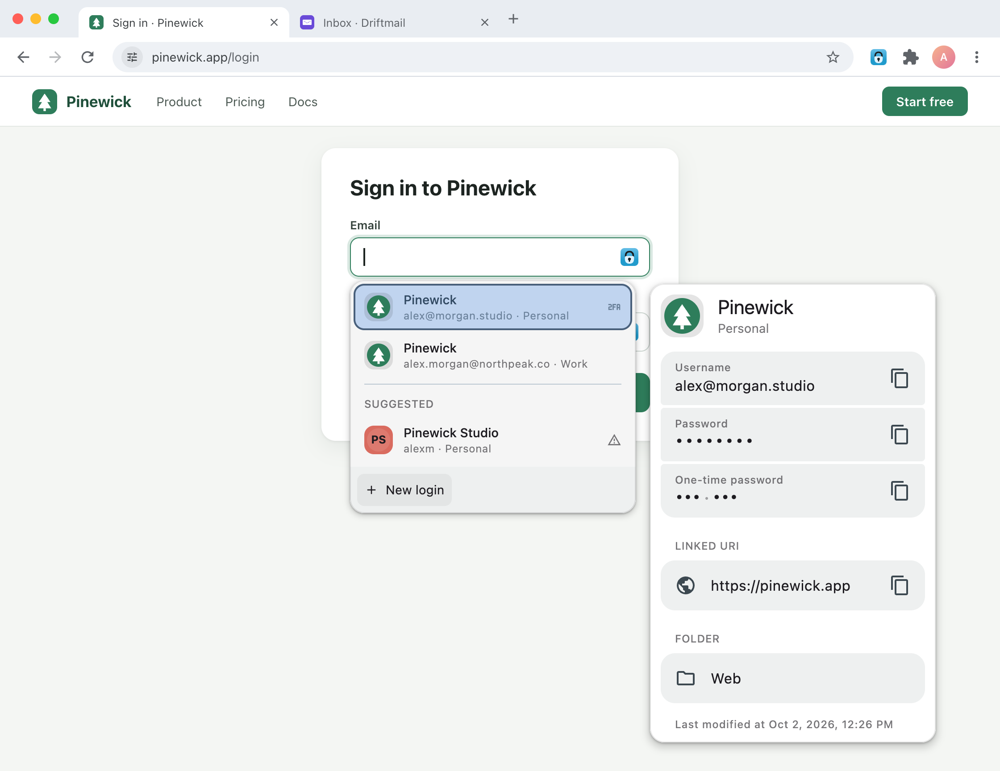
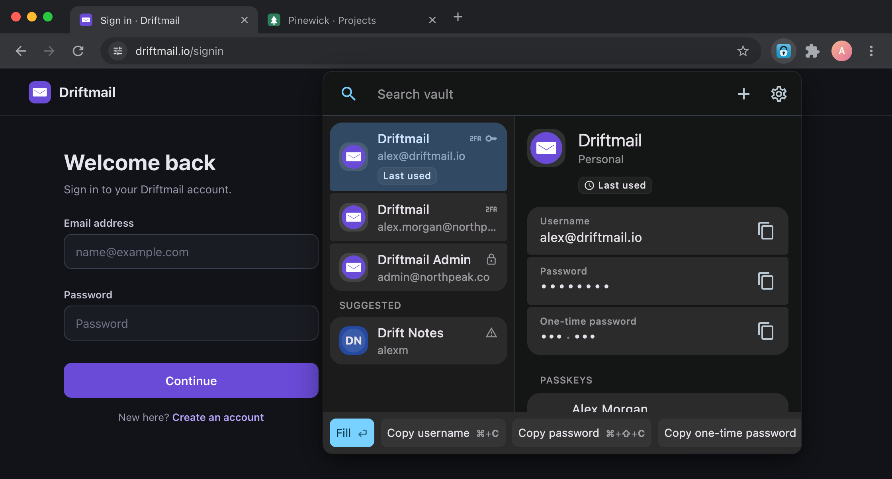
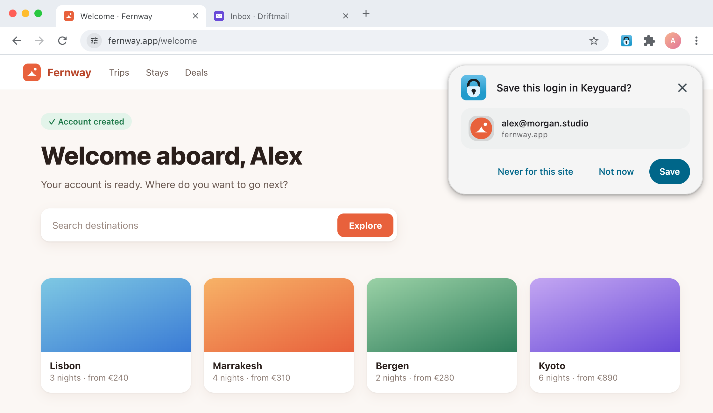

The Keyguard extension fills logins, one-time passwords and passkeys in your
browser from the Keyguard desktop app. A connector bundled with Keyguard
relays the extension's end-to-end encrypted traffic to the running app.

A paired browser gets matching logins and their secrets while the vault is
unlocked. Keyguard still asks for items with **Auth re-prompt**, logins that
don't match the site, and fills in another site's frame.
[Agent approvals](/docs/agent-approvals/#approval-window) covers how to make
Keyguard ask.

### Before you begin

- Keyguard running on desktop, from a build that supports the extension. See
  [Limitations](#limitations).
- Google Chrome, Chromium, Microsoft Edge, Brave or Vivaldi, based on Chromium
  130 or later; or Firefox 140 or later.

## Set up the extension

1. In Keyguard, open **Settings > Autofill > Browser extension**.
2. While **Enable browser extension** is on, the default, Keyguard installs
   a connector for each browser found.
3. Install the Keyguard extension from the store link on this screen.
4. In the browser, select the Keyguard icon in the toolbar, then select
   **Pair**. The popup shows a 6-digit code.
5. Compare it with the code in Keyguard's **Pair a browser** prompt. If the
   codes differ, select **Deny**.
6. To use another name, change **Browser name**.
7. Select **Approve**. The popup lists the logins for the current page.

Pairing needs an unlocked vault. Keyguard keeps pairings outside the vault, to
recognize browsers while it's locked. The vault confirms them: after you reset
or replace it, pair each browser again.

### Flatpak

Inside Flatpak, Keyguard finds a browser only if its connector folder exists
on the host. For Firefox, that's `~/.mozilla/native-messaging-hosts`; for
other browsers, `NativeMessagingHosts` in their `~/.config` folder, such as
`~/.config/google-chrome/NativeMessagingHosts`. Flathub browsers keep theirs
in `~/.var/app/<app ID>`, such as
`~/.var/app/org.mozilla.firefox/.mozilla/native-messaging-hosts` or
`~/.var/app/com.google.Chrome/config/google-chrome/NativeMessagingHosts`. To
add a browser, create its folder, then restart Keyguard.

The sandbox hides the connector's process from Keyguard. Prompts show
"Unverified connector: Keyguard couldn’t check the program that connected."

## Fill a login

1. On a sign-in page, select the Keyguard icon in the username or password
   field.
2. Select a login.
3. If Keyguard asks, select **Approve**.

You can also select a login in the popup, then **Fill**. Or press
Ctrl+Shift+L (Cmd+Shift+L on macOS). The browser's shortcut settings change
the key.

Matching logins come first, then **Suggested** ones, whose name or username
looks like the site. **Last used** marks the login filled in this tab and
origin within 5 minutes, or else on this device. The shortcut fills it,
preferring matches.

Logins match as in [URL matching](/docs/url-matching/); on an `http` page,
only `http://` URLs match. Sites in [Blocked URIs](/docs/blocked-uris/) get
no logins, unless their rule is **Saving only**. Only **Fill the password
step** fills on its own. The extension skips hidden or transparent fields.

If the vault is locked, select **Unlock** in the popup, or
**Unlock Keyguard** in the inline menu.

## Fill a one-time password

For 2 minutes after a login fill, a one-time password field in the same tab
and origin offers **Fill one-time password** in its inline menu. The shortcut
fills the code too. In the popup, **Copy one-time password** copies it.

## Save a login

After you sign in or sign up, the extension asks "Save this login in
Keyguard?".

1. Select **Save**, or **New login** in the popup or inline menu. The **Save
   login** window shows a new login, or the matching one with the new password.
2. Check the fields, then select **Save**.

**Never for this site** adds the site to [Blocked URIs](/docs/blocked-uris/)
as **Saving only**.

## Use passkeys

To sign in with a passkey, select it in Keyguard's prompt. To create one, pick
the item to save it to in Keyguard's window. Confirm your identity, unless the
site doesn't need it or you unlocked the vault for this request. On a field that
offers passkey autofill, the inline menu also lists the site's passkeys.

The browser handles a request itself when Keyguard isn't connected, the tab
is in the background, or the request is for **Use another device**, a security
key or another site's frame.

## Manage paired browsers

**Paired browsers**, in **Settings > Autofill > Browser extension**, lists each
browser with its last use; an open connection shows **Connected**.

Select a browser, then select **Rename** or **Remove**. A removed browser
disconnects and must pair again.

## Install connectors from the command line

[Browser connectors](/docs/cli/#browser-connectors) lists the `keyguard`
commands that install the same connectors.

## Review request history

In **Settings > Autofill > Browser extension**, select **Request log**. It
lists each request with its browser and result. Requests from private windows
aren't logged and don't change the item's usage history.

## Extension options

Open these in the extension's options page.

| Option | What it does | Default |
| --- | --- | --- |
| **Inline suggestions** | Shows matching logins next to login fields | On |
| **Fill the password step** | Fills the password on the page after a username fill, once, within 2 minutes | On |
| **Sign in after filling** | Selects the sign-in or next button after a login fill | Off |
| **Ask to save data** | Offers to save a login after you sign in or sign up | On |
| **Turn off browser password saving** | Stops the browser from offering to save passwords, with the `privacy` permission | Off |
| **Passkeys support** | Lets Keyguard answer the passkey requests of websites | On |

## Connector statuses

Each browser under **Browser connectors** has a switch and shows one of these.

| Status | Meaning | Fix |
| --- | --- | --- |
| **Installed** | The browser starts this copy of Keyguard's connector. | None |
| **Not installed** | The browser has no connector. | Turn the browser on. |
| **Needs repair** | The connector points at another copy of Keyguard, or differs from the one Keyguard writes. | Follow the error under the list, then select **Retry**. |

While **Enable browser extension** is on, Keyguard repairs connectors at
startup and when you open its settings, skipping browsers you turned off and
files it didn't write.

Browsers that read one connector share a switch, such as Chrome and Brave on
macOS.

## Connection statuses

When the extension can't use Keyguard, the popup shows one of these.

| Message | Cause | Fix |
| --- | --- | --- |
| "Connector not installed" | The browser has no connector. | Turn on **Enable browser extension**, or the browser under **Browser connectors**. Then switch back to the browser. |
| "Keyguard isn’t running" | The app isn't running or closed the connection. | Open Keyguard. |
| "Browser extension is off" | **Enable browser extension** is off. | Turn on **Enable browser extension**. |
| "Connector needs an update" | The app or its connector is out of date. | Update Keyguard, then open it. |
| "Update the Keyguard extension" | The app no longer supports this extension. | Update the extension. |
| "Update the Keyguard app" | The app can't read its browser pairings. | Update the app, then select **Retry**. |
| "Connector not verified" | Keyguard refused a connector it didn't bundle. | Restart Keyguard, which repairs its connectors. |
| "Too many browsers connected" | Keyguard serves at most 8 browser connections. | Close another browser or profile using the extension, then select **Retry**. |

## Limitations

| Build or platform | Limitation |
| --- | --- |
| Mac App Store, native macOS app | No browser extension. Use the DMG build. |
| Microsoft Store, MSIX | Keep the `keyguard-browser-host.exe` app execution alias on. |
| Linux | Browsers installed with Snap, such as Firefox on Ubuntu, can't start the connector. |
| macOS | No Safari extension |

## Troubleshooting

### "Keyguard’s key changed"

The app that answered isn't the copy of Keyguard this browser paired with, as
after a reinstall or when another copy runs.

If you know the cause, select **Pair again** and compare the codes. Otherwise,
don't pair: another program may be posing as Keyguard.

### The popup still shows "Connector not installed" while the connector is on

The browser runs in a Snap sandbox.

Install the vendor's `.deb`, or the Flathub build except Vivaldi's. Then
restart Keyguard.

### A site shows no logins

No login's URL matches the page. Add the site to the login, or change its
match mode as in [URL matching](/docs/url-matching/).

If the popup reads "This site matches a blocked URI. Keyguard doesn’t fill
here.", remove the rule in [Blocked URIs](/docs/blocked-uris/).
